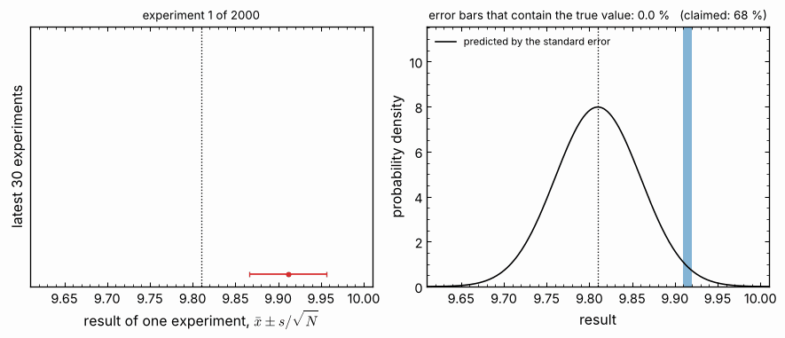
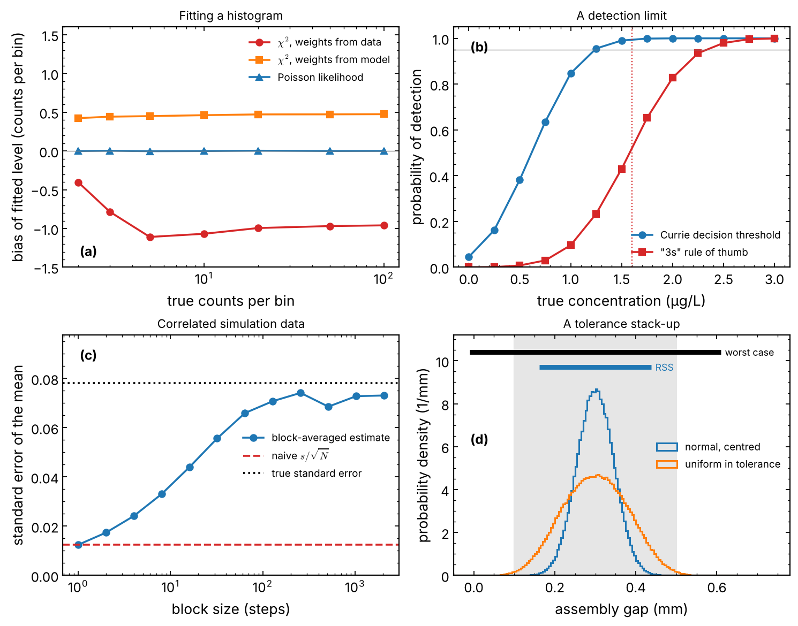
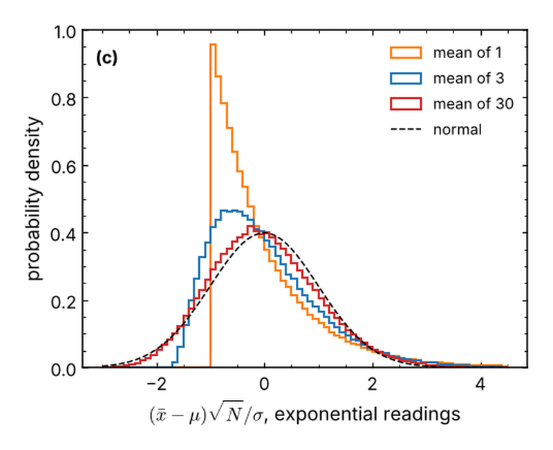
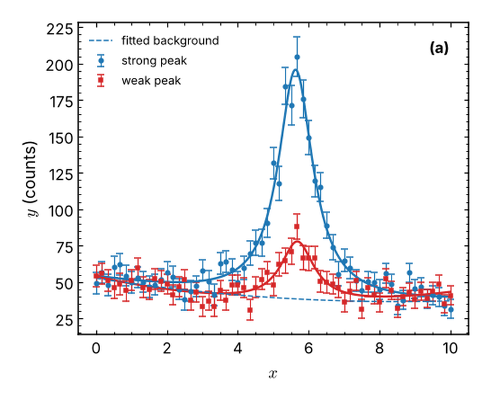
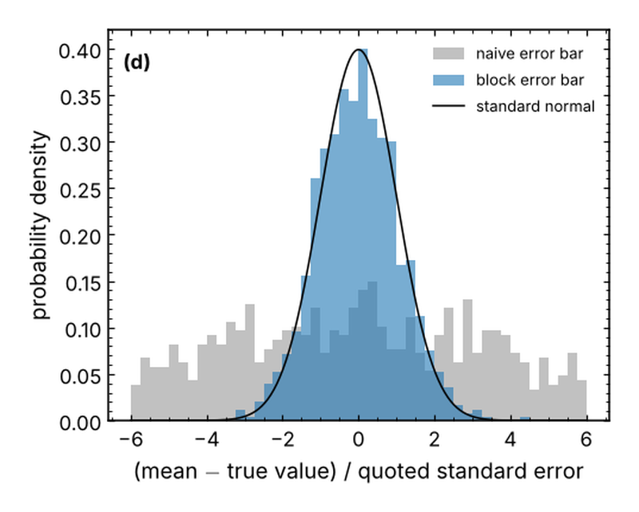
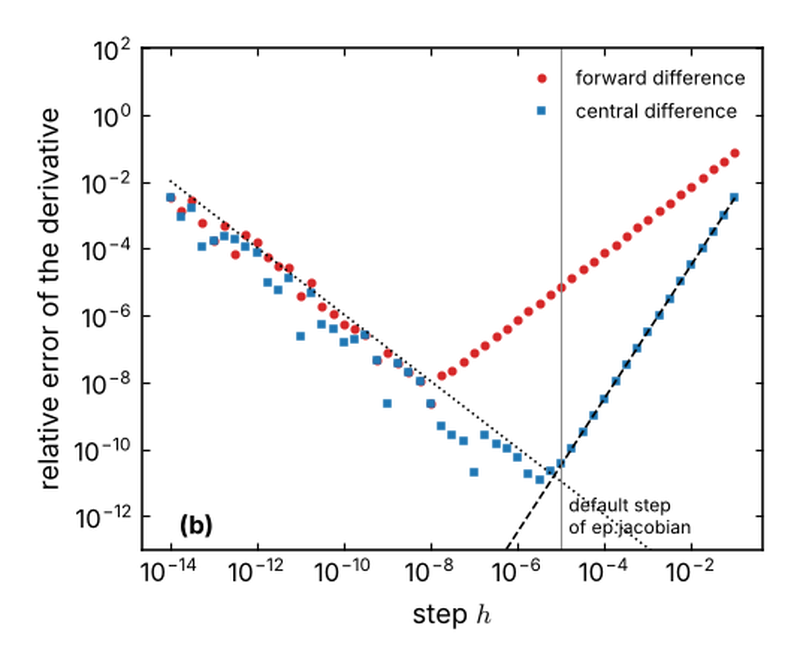
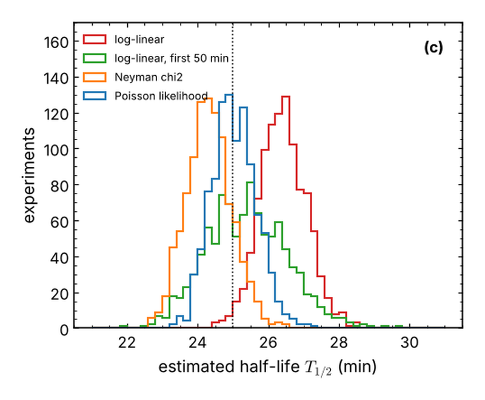
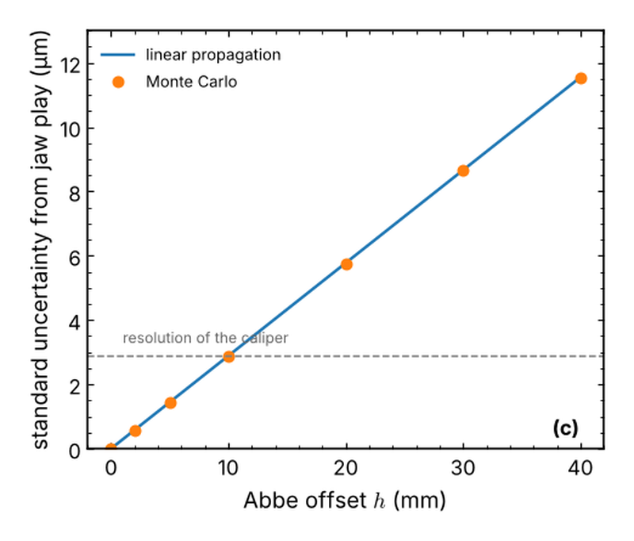

<div align="center">

# Error analysis and propagation

**An open book on evaluating, propagating and reporting uncertainty — from the first ± to the
covariance matrix of a fit, with every method tested on data whose true answer is known.**

[](https://github.com/ktwyw/error-analysis/actions/workflows/tests.yml)
[](https://ktwyw.github.io/error-analysis/)
[](pyproject.toml)
[](#whats-inside)
[](LICENSE)
[](DATA_LICENSE.md)



<sub>The test applied throughout the book. An experiment (the mean of 25 readings, reported as mean ± standard error) is repeated 2000 times. Error bars that miss the true value are red; in the long run about 68 % contain it, as a standard uncertainty claims. (<code>scripts/make_readme_animation.py</code>)</sub>

</div>

Every number in science and engineering comes with an uncertainty. Yet the subject is usually taught
once, as a set of recipes in a first-year laboratory, and seldom carried into the places where it is
needed later: curve fitting, counting experiments, correlated simulation data, numerical computation,
and the systematic effects that no formula for random error will reveal. This repository treats error
analysis as one connected subject. It contains **26 executed Jupyter notebooks** in five parts, **7 worked
examples** from different disciplines, a small tested Python module (**`errprop`**), and a
**[reading guide](docs/reading_guide.md)** that maps every chapter to the standard textbooks and to the GUM.

> **Start in 60 seconds:** open [Chapter 1](notebooks/part1_measurement/01_measurement_and_uncertainty.ipynb)
> here on GitHub (the notebooks are stored with their outputs), or go straight to
> [Chapter 16](notebooks/part3_data_analysis/16_rules_of_thumb_tested.ipynb), where nine familiar rules
> of thumb are put to the test.

## Why this book?

- **Tested against the truth.** All experimental data are simulated, so the true answer is known. Each
  method is derived, demonstrated, and then checked on thousands of repeated experiments: does the error
  bar cover the truth as often as it claims?
- **One connected subject.** The same law, $C_y = J\,C_x\,J^{\mathsf T}$, runs from the uncertainty of a
  product to the covariance of fit parameters, uncertainty budgets and tolerance analysis.
- **Across disciplines.** Worked examples from physics, chemistry, chemical and mechanical engineering,
  nuclear physics, analytical chemistry and molecular simulation.
- **Two tracks.** *Core* chapters need only partial derivatives and a first look at Python. *Advanced*
  chapters are for graduate students and researchers who fit data, run simulations or publish numbers with
  error bars.
- **Built on the standard texts.** Every chapter points to the corresponding sections of Taylor,
  Bevington & Robinson, Fornasini, Rouaud and the GUM, and cites books and published articles in
  preference to online notes.
- **Readable code.** `errprop` is a few hundred lines of NumPy, written to be read alongside the text; the
  notebooks need only NumPy, SciPy and Matplotlib.

## What the simulations show

<p align="center">

</p>

*Four results, recomputed by `scripts/make_readme_figure.py`. (a) Least-squares fits to a histogram are
biased by a fixed number of counts per bin; the Poisson likelihood is not (Chapter 15). (b) The "3s" rule
detects only about half of the samples at its own detection limit, the dotted line (Chapter 25). (c) For
correlated data the naive standard error is here six times too small; block averaging recovers the true
value (Chapter 17). (d) Worst-case and root-sum-of-squares tolerancing against a simulated production
(Chapter 26).*

Given a fair test, some common recipes fail it:

- **A half-life from the textbook straight-line fit** to the logarithm of the counts comes out about two
  standard deviations too long, and its error bar contains the true value in one experiment out of ten
  ([Chapter 24](notebooks/part5_examples/24_radioactive_decay_counts.ipynb)).
- **A χ² fit to a histogram** gets the peak right and the background wrong, by −30 % or +15 % depending
  on how the weights are chosen
  ([Chapter 15](notebooks/part3_data_analysis/15_maximum_likelihood_fitting.ipynb)).
- **A complete, careful uncertainty budget** can still miss the truth by fourteen times its stated
  uncertainty, when the formula itself is at fault
  ([Chapter 21](notebooks/part5_examples/21_falling_sphere_viscosity.ipynb)).
- **"Not detected (< 3s)"** means that a sample at that level had an even chance of being missed
  ([Chapter 25](notebooks/part5_examples/25_calibration_curve_detection_limit.ipynb)).
- **The one-pass textbook formula for the variance** returns no correct digits for readings whose common
  offset is 10⁸ times their spread ([Chapter 19](notebooks/part4_advanced/19_numerical_error.ipynb)).

## Installation

```bash
git clone https://github.com/ktwyw/error-analysis.git
cd error-analysis
pip install -e ".[notebooks]"
jupyter lab
```

Each notebook generates its own data from a fixed random seed and runs in under half a minute.

## Quick start

**Propagation, a budget and a Monte Carlo check** — the density of a cylinder:

```python
import numpy as np
import errprop as ep

density = lambda m, d, h: 4 * m / (np.pi * d**2 * h)
x = [23.45e-3, 9.98e-3, 35.10e-3]          # mass (kg), diameter (m), height (m)
u = [0.01e-3, 0.02e-3, 0.05e-3]            # standard uncertainties

rho, u_rho = ep.propagate(density, x, u)   # first-order propagation
print(ep.format_result(rho, u_rho, "kg/m^3"))            # 8541 ± 37 kg/m^3

rows, *_ = ep.budget(density, x, u, names=["m", "d", "h"])
print(ep.format_budget(rows))              # the diameter carries 88 % of the variance

samples = ep.monte_carlo(density, x, u)    # Monte Carlo check of the linear result
```

**A straight-line fit with its covariance** — simulated data, so the true line ($y = 2 + 0.5x$) is known:

```python
rng = np.random.default_rng(1)
x = np.linspace(0, 10, 11)
y = 2.0 + 0.5 * x + rng.normal(0, 0.3, x.size)          # readings with sigma = 0.3

fit = ep.linear_fit(x, y, np.full(x.size, 0.3))
print(ep.format_result(fit.slope, fit.u_slope))          # 0.497 ± 0.029
print(ep.format_result(fit.intercept, fit.u_intercept))  # 2.08 ± 0.17
print(round(fit.correlation, 2))                         # -0.85: slope and intercept are correlated
```

## Gallery

| | |
|:-:|:-:|
| <br>The central limit theorem at work on skewed readings ([Chapter 5](notebooks/part2_probability_statistics/05_probability_distributions.ipynb)) | <br>A strong and a weak peak fitted by nonlinear least squares ([Chapter 14](notebooks/part3_data_analysis/14_nonlinear_least_squares.ipynb)) |
| <br>Correlated data: naive error bars against block averaging ([Chapter 17](notebooks/part4_advanced/17_correlated_data_and_block_averaging.ipynb)) | <br>The best step for a numerical derivative ([Chapter 19](notebooks/part4_advanced/19_numerical_error.ipynb)) |
| <br>One half-life, four fitting methods, 1000 experiments ([Chapter 24](notebooks/part5_examples/24_radioactive_decay_counts.ipynb)) | <br>The Abbe error of a caliper ([Chapter 26](notebooks/part5_examples/26_tolerance_stack_up.ipynb)) |

The panels are cut from the figures stored in the notebooks by `scripts/make_readme_gallery.py`.

## What's inside

<!-- chapters:start -->

**Part I. Measurement and uncertainty**

| Chapter | Track | Topics |
|---|:-:|---|
| [1. Measurements, errors and how to report a result](notebooks/part1_measurement/01_measurement_and_uncertainty.ipynb) | core | error vs uncertainty; random and systematic effects; Type A and Type B evaluation; quadrature; rounding and reporting; comparing results |
| [2. Measuring instruments](notebooks/part1_measurement/02_measuring_instruments.ipynb) | core | static characteristics; resolution, noise and dithering; calibration and accuracy specifications; first-order dynamic response and lag correction |
| [3. Propagation of uncertainty](notebooks/part1_measurement/03_propagation_of_uncertainty.ipynb) | core | the propagation law; rules for sums, products and powers; uncertainty budgets; Monte Carlo check; differences of nearly equal numbers |
| [4. Repeated measurements](notebooks/part1_measurement/04_repeated_measurements.ipynb) | core | standard deviation and standard error; the uncertainty of the uncertainty; Student's *t*; what averaging does not cure; weighted mean |

**Part II. Probability and statistics**

| Chapter | Track | Topics |
|---|:-:|---|
| [5. Probability distributions and the central limit theorem](notebooks/part2_probability_statistics/05_probability_distributions.ipynb) | core | binomial, Poisson, normal, uniform, exponential and Cauchy distributions; the central limit theorem; χ², *t* and *F* |
| [6. Counting statistics](notebooks/part2_probability_statistics/06_counting_statistics.ipynb) | core | the square-root rule and the dispersion test; background subtraction and counting-time split; Garwood intervals for small counts; dead time |
| [7. Estimators and maximum likelihood](notebooks/part2_probability_statistics/07_estimators_and_maximum_likelihood.ipynb) | advanced | bias, variance and mean-square error; efficient and inefficient estimators; maximum likelihood; likelihood intervals; Cramér–Rao bound |
| [8. Hypothesis tests and goodness of fit](notebooks/part2_probability_statistics/08_hypothesis_tests.ipynb) | core | p-values, power and errors of both kinds; *z*, *t* and Welch tests; χ² test of a distribution; *F* test; correlation coefficient; many tests at once |
| [9. Outliers and the rejection of data](notebooks/part2_probability_statistics/09_outliers_and_data_rejection.ipynb) | core | Chauvenet's criterion tested; robust estimators (median, trimmed mean, Huber); the bootstrap; a policy for suspect data |
| [10. Monte Carlo methods](notebooks/part2_probability_statistics/10_monte_carlo_methods.ipynb) | advanced | sampling by inverse transform and rejection; correlated inputs; the accuracy of a Monte Carlo result; Latin hypercube sampling |

**Part III. Data analysis**

| Chapter | Track | Topics |
|---|:-:|---|
| [11. Fitting a straight line](notebooks/part3_data_analysis/11_fitting_a_straight_line.ipynb) | core | least squares and its parameter uncertainties; residuals; weighted fits and χ²; coverage check; pitfalls |
| [12. Covariance and the limits of linearisation](notebooks/part3_data_analysis/12_covariance_and_limits_of_linearisation.ipynb) | advanced | the general law **C**<sub>y</sub> = **J C**<sub>x</sub> **J**<sup>T</sup>; shared errors; staged calculations; second-order bias; Monte Carlo propagation |
| [13. Fit parameters and their covariance](notebooks/part3_data_analysis/13_fit_parameter_covariance.ipynb) | advanced | matrix form of least squares; correlated slope and intercept; centring; transformed data and weights; absolute vs relative error bars; errors in both variables |
| [14. Nonlinear least squares](notebooks/part3_data_analysis/14_nonlinear_least_squares.ipynb) | advanced | Gauss–Newton and Levenberg–Marquardt; local minima and starting values; covariance at the minimum; profile Δχ² intervals; derived quantities; coverage |
| [15. Fitting counts: maximum likelihood](notebooks/part3_data_analysis/15_maximum_likelihood_fitting.ipynb) | advanced | Neyman vs Pearson χ² vs Poisson likelihood for histograms; goodness of fit with few counts; unbinned likelihood with a finite window |
| [16. Rules of thumb, tested](notebooks/part3_data_analysis/16_rules_of_thumb_tested.ipynb) | core | nine rules from course guides tested by simulation: worst case vs quadrature, overlapping error bars, limits of linearisation, the dependency trap, measuring many at once, dropping small terms, significant figures, offsets and gains, cancelling errors |

**Part IV. Advanced topics**

| Chapter | Track | Topics |
|---|:-:|---|
| [17. Correlated data and block averaging](notebooks/part4_advanced/17_correlated_data_and_block_averaging.ipynb) | advanced | variance of the mean of a time series; integrated autocorrelation time; blocking analysis; coverage test; jackknife for derived quantities |
| [18. Sensitivity analysis and uncertainty budgets](notebooks/part4_advanced/18_sensitivity_analysis_and_budgets.ipynb) | advanced | sensitivity, elasticity and importance; budgets across operating points; bottom-up vs top-down; Sobol indices; aleatory vs epistemic uncertainty; model-form error |
| [19. Numerical error](notebooks/part4_advanced/19_numerical_error.ipynb) | advanced | floating point and cancellation; Welford's algorithm; conditioning; step size of numerical derivatives; Richardson extrapolation; long-time integration |

**Part V. Worked examples**

| Chapter | Track | Topics |
|---|:-:|---|
| [20. Physics: the acceleration of gravity from a pendulum](notebooks/part5_examples/20_pendulum_g.ipynb) | core | physics: a systematic error that shows up as a trend; a fit that absorbs it; a correction common to all points |
| [21. Chemical engineering: viscosity from a falling sphere](notebooks/part5_examples/21_falling_sphere_viscosity.ipynb) | core | chemical engineering: Type B evaluation; a full budget; a model error fourteen times the budget; defining the measurand |
| [22. Chemistry: activation energy from an Arrhenius plot](notebooks/part5_examples/22_arrhenius_activation_energy.ipynb) | advanced | chemistry: parameters with correlation 0.999; prediction with and without covariance; the statistical compensation effect |
| [23. Molecular simulation: pressure and diffusion in a Lennard-Jones liquid](notebooks/part5_examples/23_md_lennard_jones.ipynb) | advanced | molecular simulation: correlated time series; block averaging on real MD data; transport coefficients; what an error bar leaves out |
| [24. Nuclear physics: a half-life from decay counts](notebooks/part5_examples/24_radioactive_decay_counts.ipynb) | advanced | nuclear physics: why the log-linear fit is biased; background in the likelihood; checking four methods by simulation |
| [25. Analytical chemistry: a calibration curve and its detection limit](notebooks/part5_examples/25_calibration_curve_detection_limit.ipynb) | core | analytical chemistry: inverse prediction and its uncertainty; decision threshold and detection limit (Currie); the 3s rule tested |
| [26. Mechanical engineering: tolerance stack-up and inspection](notebooks/part5_examples/26_tolerance_stack_up.ipynb) | core | mechanical engineering: worst case vs RSS vs Monte Carlo tolerancing; yield and C<sub>pk</sub>; the Abbe error; guard bands at inspection |
<!-- chapters:end -->

**Where to start**

| If you are… | Read |
|---|---|
| a student in a first laboratory course | Chapters 1–4, 11 and 16, then Examples 20 and 25 |
| an experimenter who needs the statistics | Part II, then Chapters 14 and 15 and Example 24 |
| fitting data for a paper | Chapters 11–15 and 17, with Examples 22 and 24 |
| an engineer preparing an uncertainty budget | Chapters 2, 3, 12, 18 and 19, with Examples 21 and 26 |
| running simulations | Chapters 10, 17 and 19, with Example 23 |
| an instructor | Chapter 16, to see which textbook recipes hold up |

## The `errprop` module

| Area | Functions |
|---|---|
| Propagation | `propagate`, `jacobian`, `budget`, `format_budget`, `monte_carlo`, `summarize` |
| Statistics | `mean_sem`, `weighted_mean`, `autocorrelation`, `integrated_autocorrelation_time`, `sem_correlated`, `block_means`, `block_sem`, `blocking_curve`, `bootstrap`, `jackknife` |
| Fitting | `linear_fit` (slope, intercept, covariance, χ², prediction band), `general_linear_fit`, `nonlinear_fit` (Levenberg–Marquardt; parameters, covariance, χ², p-value) |
| Counting and robust statistics | `poisson_interval` (Garwood), `mad`, `huber_location` |
| Sensitivity | `elasticities`, `sobol_indices` (Saltelli/Jansen estimators with bootstrap errors), `ishigami`, `ishigami_exact` |
| Numerical error | `observed_order`, `richardson` |
| Reporting | `format_result`, `format_concise`, `round_to_uncertainty` |
| Plotting | `use_style`, `panel_label` (boxed axes, inward ticks) |

## Repository layout

| Folder | Contents |
|---|---|
| [`notebooks/`](notebooks) | The 26 chapters, executed, in five folders (`part1_measurement` … `part5_examples`) |
| [`errprop/`](errprop) | The Python module |
| [`tests/`](tests) | 34 tests of the module against closed-form results |
| [`docs/`](docs) | [Reading guide](docs/reading_guide.md), [references](docs/references.md), book front page, images |
| [`scripts/`](scripts) | The MD code behind `data/`, and the scripts that make the images on this page |
| [`data/`](data) | Molecular dynamics time series analysed in Chapter 23 |

To run the tests, re-execute the notebooks, or build the book as a website with
[Jupyter Book](https://jupyterbook.org) (version 2, which needs Node.js):

```bash
pip install -e ".[test]" && pytest
jupyter nbconvert --to notebook --execute --inplace notebooks/*/*.ipynb
pip install jupyter-book && jupyter-book build --html    # output in _build/html
```

The workflow `.github/workflows/book.yml` publishes the site to GitHub Pages on every push to `main`.

## Reading and references

Each chapter opens with a *Reading* line; the **[reading guide](docs/reading_guide.md)** collects them
in one table and suggests routes through the book. The four textbooks behind it:

- J. R. Taylor, *An Introduction to Error Analysis*, 2nd ed. (University Science Books, 1997).
- P. R. Bevington and D. K. Robinson, *Data Reduction and Error Analysis for the Physical Sciences*,
  3rd ed. (McGraw-Hill, 2003).
- P. Fornasini, *The Uncertainty in Physical Measurements* (Springer, 2008).
- M. Rouaud, *Probability, Statistics and Estimation* (2017).

together with JCGM 100:2008 (the GUM) and its supplements. All books and articles cited in the chapters
are listed in **[`docs/references.md`](docs/references.md)**. They are cited, not redistributed.

## Scope and limitations

The book follows the GUM: the number after ± is a standard uncertainty (one standard deviation) unless
stated otherwise, and the treatment is frequentist; a Bayesian view is on the roadmap. The experimental
data are simulated. The single data sets shown were chosen to be representative, and the coverage of the
error bars is always checked on many repetitions; the molecular dynamics data in `data/` are the output
of a real simulation. `errprop` is a teaching module: for automatic propagation through long expressions,
the [`uncertainties`](https://pythonhosted.org/uncertainties/) package is the established tool.

## Roadmap

- [ ] Model error and validation: convergence studies as error estimates, validation metrics
- [ ] A Bayesian view of the same problems
- [ ] More examples: DFT convergence error, a heat-exchanger energy balance, a pharmacokinetic half-life
- [ ] Solutions to the exercises
- [ ] Real published data sets alongside the simulated ones

Suggestions for examples from other fields are welcome as
[GitHub issues](https://github.com/ktwyw/error-analysis/issues). Notebooks were renumbered in version
0.3; see [`CHANGELOG.md`](CHANGELOG.md).

## Author

**Yanwei Wang** [](https://orcid.org/0000-0002-8488-9833)

Department of Chemical and Materials Engineering, School of Engineering, Nazarbayev University.
This is a personal project, developed for teaching error analysis to students of science and
engineering.

[GitHub](https://github.com/ktwyw) ·
[ORCID](https://orcid.org/0000-0002-8488-9833) ·
[Google Scholar](https://scholar.google.com/citations?user=PAAv_KMAAAAJ&hl=en) ·
[ResearchGate](https://www.researchgate.net/profile/Yanwei-Wang-19) ·
[LinkedIn](https://www.linkedin.com/in/yanwei-wang-1228b12/) ·
yanwei.wang@nu.edu.kz

## Citing

If you use this material in teaching or research, please cite it using the metadata in
[`CITATION.cff`](CITATION.cff) (GitHub shows a "Cite this repository" button).

## License

Code: [MIT](LICENSE). Text, figures and data: [CC BY 4.0](DATA_LICENSE.md).
